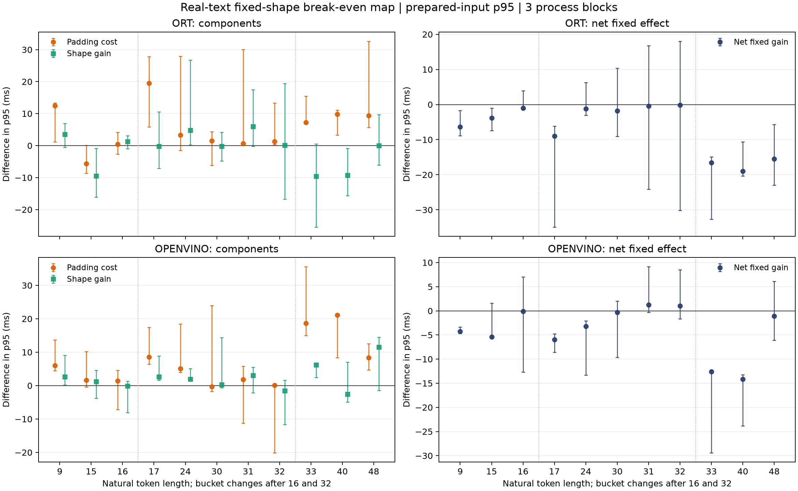

# Real-text break-even map: measured outcome

The [frozen protocol](breakeven-map-protocol.md) specified 11 exact token lengths, 24 previously unused SST-2 training sentences per length, the same standard FP32 ONNX graph family in both CPU backends, and three fresh process blocks per backend/capacity. The [complete archive](../results/breakeven-map/summary.json) holds all process results and [checksums](../results/breakeven-map/checksums.json). This is a map of *observed* lengths, not an interpolated threshold or a new routing policy.

## How to read the map

For each length and process, we measured the p95 of three paths: dynamic at the natural length, dynamic padded to the next bucket, and fixed at that same padded bucket. The primary p95 includes input padding and inference, but excludes tokenization, model compilation, and request routing. We define **padding cost** as padded-dynamic minus natural-dynamic p95; **shape gain** as padded-dynamic minus padded-fixed p95; and **net fixed gain** as natural-dynamic minus padded-fixed p95. Positive net gain means fixed was faster. These three differences satisfy `net gain = shape gain − padding cost` *within each process*. The displayed medians are calculated separately across three process blocks and therefore need not satisfy that identity after aggregation.



Dots are medians of three process-block p95 differences; whiskers show the complete block range. The x positions are spaced for legibility, with dotted lines between the 16-, 32-, and 64-token buckets. No result is inferred between the tested lengths. The right-hand zero line is the measured break-even condition: above it fixed wins, below it natural dynamic wins. When the whisker crosses zero, the process blocks disagreed.

As a concrete measured example, at **33 tokens in one OpenVINO block**, padding to 64 cost **18.71 ms** at p95 while the fixed shape gained **6.48 ms** over the equally padded dynamic graph. The net fixed gain was **−12.23 ms**. This illustrates why finding a same-shape optimization is insufficient for a useful route. At 31 tokens, OpenVINO's net effect changed sign across blocks, so the map does not identify a reliable crossover there.

## Observations

The following numbers are medians of the **within-process** net fixed p95 difference in milliseconds. Parentheses give the number of three blocks favoring fixed; negative values favor natural dynamic.

| Natural tokens | Fixed bucket | ORT net gain (blocks) | OpenVINO net gain (blocks) |
| ---: | ---: | ---: | ---: |
| 9 | 16 | −6.33 (0/3) | −4.28 (0/3) |
| 15 | 16 | −3.86 (0/3) | −5.38 (1/3) |
| 16 | 16 | −1.04 (1/3) | −0.08 (1/3) |
| 17 | 32 | −8.94 (0/3) | −5.99 (0/3) |
| 24 | 32 | −1.25 (1/3) | −3.20 (0/3) |
| 30 | 32 | −1.77 (1/3) | −0.29 (1/3) |
| 31 | 32 | −0.40 (1/3) | +1.26 (2/3) |
| 32 | 32 | −0.18 (1/3) | +1.02 (2/3) |
| 33 | 64 | −16.55 (0/3) | −12.60 (0/3) |
| 40 | 64 | −19.03 (0/3) | −14.12 (0/3) |
| 48 | 64 | −15.47 (0/3) | −1.10 (1/3) |

The prespecified screen required positive net gain in **all three** blocks and a median paired p95 reduction of at least 5%, with output, power, and memory checks passing. **No length in either backend passed.** ORT favored natural dynamic in all three blocks at 9, 15, 17, 33, 40, and 48 tokens; OpenVINO did so at 9, 17, 24, 33, and 40. Every other tested cell had mixed block directions. There were no all-fixed-favoring cells. The 31–32 token OpenVINO medians are small and inconsistent; they are leads for measurement improvement, not candidate routes under the frozen rule.

## Integrity and limits

The study used 264 fresh training sentences, excluding the earlier 768 policy/real-31 IDs. It completed **18 fresh processes and 9,504 timed requests**. Every timed output passed the separate PyTorch eager FP32 logit comparison at `atol=rtol=1e-4`; there were zero changed labels. Maximum absolute logit error was 5.25e-6 for ORT and 4.53e-6 for OpenVINO. AC connection and Windows power-scheme snapshots were consistent throughout, and the maximum observed interval between consecutive one-second CPU samples was 1.03 seconds. The maximum sampled two-session process RSS was **1,205.0 MiB**, below the existing 1,536 MiB cap. OpenVINO readback showed FP32, four threads, one stream, `ANY_CORE` scheduling, and CPU pinning disabled for every compiled pair. These observations do not measure temperature, frequency, or per-core placement.

Absolute p95 varied substantially across blocks: the largest high/low ratio for natural-dynamic p95 at one length was **4.27×** in ORT and **3.42×** in OpenVINO. Matched within-process contrasts reduce some shared variation, but several net-gain ranges still cross zero. We therefore cannot claim an exact break-even token length or a stable general speedup. The diagnostic identifies clear losses just above bucket boundaries and uncertainty near the almost-full 32-token bucket. It cannot establish what would happen at 63–65 or 127–129 tokens: the pinned SST-2 train split had too few unused exact-length rows at 63 (5), 64 (1), and 65 (2) for the prespecified 24-row sampling rule. A different real-text source would be needed for those boundaries.

This study uses the released classifier on SST-2 training text, so it does not estimate classifier generalization. Requests repeated within a process are dependent; no request-level confidence interval or significance test is claimed. The map screened eleven lengths in two backends, and any promising cell would require independent confirmation on new rows. No route passed even the exploratory candidate rule. The original dynamic-only ORT deployment remains the supported policy for this measured setup.

## Reproduce and extend

After generating the project's verified standard graphs, run from the repository root:

```powershell
uv sync --locked --extra openvino
uv run python tools/breakeven_map.py prepare
uv run python tools/breakeven_map.py references
uv run python tools/breakeven_map.py run
uv run python tools/plot_breakeven_map.py
```

The [plan](../results/breakeven-map/plan.json), [selected workload](../results/breakeven-map/workload.json), [references](../results/breakeven-map/references.json), process records, and chart are archived. The plan's sample and graph hashes were committed before timing. Sampling was first prepared while the laptop was on battery; its planned power snapshot was updated after AC was connected, before any timing, without changing selected rows, graphs, or code. Human review of this interpretation remains pending.
