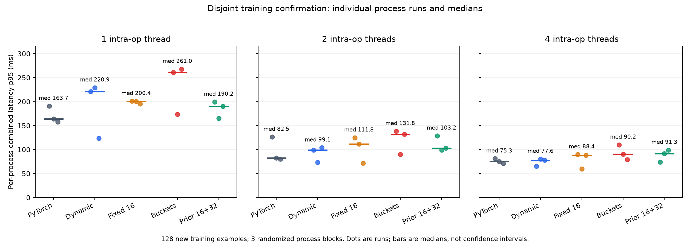
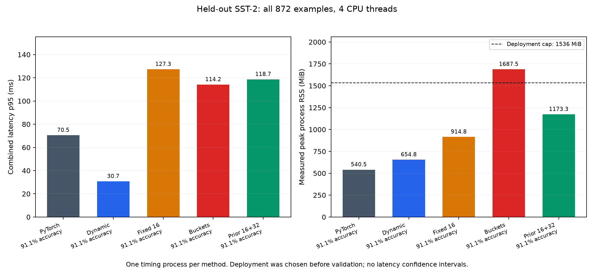

# Final experiment: confirmation and held-out evaluation

Completed November 9, 2026. The initial 16+32-token calibration gain did not
survive the stronger confirmation protocol. Among the prespecified ONNX
deployment candidates, the final rule selected **dynamic-only execution at four
CPU threads**, with no fixed variants retained. The policy was frozen before
validation was accessed.

All five compared implementations produced identical predictions on all **872
validation examples**: **794 correct, 91.06% accuracy**, with zero changed labels
against the PyTorch reference. The observed dynamic-only held-out p95 was
**30.695 ms**, at **654.8 MiB peak process RSS**, below the **1,536 MiB cap**.
That latency is one timing run, not a stable population estimate or a confidence
interval. This is a useful negative result for the specialization hypothesis on
this machine: keeping extra variants was not justified by the confirmed candidates.

## Protocol and separation of data

The [protocol](comparison-protocol.md) was committed before new measurements.
The original policy was learned on 64 SST-2 training examples. Confirmation used
128 different training rows, excluding all 64 selection IDs. No new length routes
or variant sets were fitted during confirmation; the original 16+32 candidate was
kept fixed while thread counts were compared.

Confirmation comprised five methods, 1/2/4 intra-op threads and three randomized
blocks: **45 fresh processes and 5,760 timed requests**. Every condition saw the
same input order within a block. Idle ORT thread spinning was explicitly disabled
for these experiments. Thus absolute times should not be directly equated with
the earlier study's runtime defaults. Each method received capacity probes and
10 warm-up requests. Reference generation ran separately from timing and memory
measurement; every timed output was checked after its timer stopped.

The final choice minimized median process-run p95 among dynamic and the prior
policy at the three thread counts, requiring every run to pass score/label checks
and peak memory to fit the cap. PyTorch, single-fixed and bucket methods were
comparisons rather than additional ONNX deployment candidates. PyTorch was also
competitive; the result does not establish a universally best inference backend.

The frozen plan then evaluated all five methods at four threads on the complete
872-example validation split, once per method in a randomized order. The prior
16+32 candidate remained a comparator even though it was rejected for deployment.
The method order was prior policy, fixed-16, PyTorch, buckets, dynamic. No policy
or thread choice changed after validation results were read. Dataset, checkpoint,
graph, reference, workload and plan hashes are archived.

Hardware/software: Intel Core i5-1334U, Windows 11, CPU PyTorch 2.10.0,
Transformers 5.1.0 and ONNX Runtime 1.31.1. Batch size one, FP32, eager PyTorch
attention, CPUExecutionProvider and ORT_ENABLE_ALL. All methods use the same
tokenizer and trained weights. The project performed no fine-tuning or quantization
and used no GPU.

## Confirmation: process-level variation

Each cell is the median of three process-run p95 values, followed by their full
range, in milliseconds. These are descriptive ranges, **not confidence intervals**.
All methods had 127/128 training-confirmation accuracy (99.22%) and zero changed
predictions in every run.

| Method | 1 thread | 2 threads | 4 threads |
| --- | ---: | ---: | ---: |
| PyTorch FP32 | 163.7 [157.5, 190.8] | 82.5 [80.3, 126.3] | 75.3 [70.9, 81.1] |
| Dynamic ONNX | 220.9 [123.3, 229.2] | 99.1 [73.6, 104.1] | **77.6 [65.4, 80.4]** |
| Fixed-16 with fallback | 200.4 [195.3, 201.0] | 111.8 [71.4, 124.9] | 88.4 [59.8, 89.8] |
| Four fixed buckets with fallback | 261.0 [173.9, 267.9] | 131.8 [89.9, 138.3] | 90.2 [78.8, 109.9] |
| Prior 16+32 policy with fallback | 190.2 [164.8, 199.5] | 103.2 [98.8, 128.9] | 91.3 [74.0, 99.1] |

Matched-block dynamic/prior-policy p95 ratios were:

| Threads | Median ratio | Range across matched blocks |
| --- | ---: | ---: |
| 1 | 1.107 | 0.648-1.390 |
| 2 | 0.769 | 0.745-1.009 |
| 4 | 0.880 | 0.783-0.884 |

A ratio below one favors dynamic execution. At four threads it was faster in
each matched block. At one thread the direction varied, illustrating why the
earlier 51 ms versus 244 ms calibration result was insufficient for deployment.
The new cohort and runtime controls also differ, so these experiments do not
isolate a single cause for the change. No formal significance test is claimed.

## Held-out results

Each row uses all 872 examples at four threads. Combined latency includes
tokenization, routing/padding and synchronous model execution. It excludes
downloads, startup, disk logging and the subsequent score comparison.

| Method | Median (ms) | p95 (ms) | Peak RSS (MiB) | Accuracy | Changed labels |
| --- | ---: | ---: | ---: | ---: | ---: |
| PyTorch FP32 | 41.720 | 70.450 | 540.5 | 91.06% | 0 |
| **Dynamic ONNX: frozen deployment** | **16.748** | **30.695** | **654.8** | **91.06%** | **0** |
| Fixed-16 with fallback | 30.961 | 127.295 | 914.8 | 91.06% | 0 |
| Four fixed buckets with fallback | 51.482 | 114.165 | 1,687.5 | 91.06% | 0 |
| Prior 16+32 policy with fallback | 89.269 | 118.657 | 1,173.3 | 91.06% | 0 |

Every method passed finite-score, `atol=rtol=1e-4`, and exact-label checks. The
largest absolute logit difference was approximately `2.05e-5`. This is empirical
equivalence on the measured examples, not a proof for every possible input.

The all-four-bucket implementation exceeded the memory cap; this does not prove
every possible bucket design is infeasible. The prior policy fit the cap but
retained more memory and was slower in this run. Validation lengths ranged from
4 to 55 tokens. The prior policy routed 154 examples to fixed-16, 300 to fixed-32
and 418 to dynamic, including unseen lengths. No input was truncated.
[Exact-length metrics](../results/milestone-3/held-out-by-length.csv) retain the
sample count for each length; sparse per-length percentiles are descriptive.

The unusually low held-out dynamic timing compared with its confirmation range
is a reason for caution about the magnitude of the apparent advantage. There is
only one held-out process per method, and timing can vary with system load,
thermal/power state, caches and method order. The recommendation was already
fixed by training confirmation and was not changed to exploit this result.

## Size and startup components

| Method | Serialized model files (MiB) | Model/session initialization (s) | Ready after probes and warm-up (s) |
| --- | ---: | ---: | ---: |
| PyTorch | 255.4 | 0.644 | 1.627 |
| Dynamic | 256.1 | 0.590 | 1.300 |
| Fixed-16 plus dynamic | 512.2 | 1.208 | 3.295 |
| Four buckets plus dynamic | 1,280.4 | 4.443 | 6.178 |
| Prior 16+32 plus dynamic | 768.2 | 4.174 | 6.443 |

Initialization is summed ORT session construction or PyTorch model loading at
the same boundary. Readiness additionally includes capacity probes and warm-up,
but excludes process imports, tokenizer loading and provenance checks. OS caches
may be warm; these are **not cold-device application startup times**.

RSS is the larger of 10 ms sampled process memory and the Windows lifetime
high-water mark. It includes runtime/tokenizer overhead and startup/probes;
it is not tensor-only memory or a sum of isolated-session peaks. Serialized sizes
count retained original model files, excluding shared tokenizer assets and the
additional optimized graph copies retained locally for inspection.

## Diagnostic kernels and ablation reanalysis

Post-experiment ORT traces used a common four-token validation input, four
profiled calls per graph, four threads and CPU execution only. They were captured
**after all performance runs**. Both dynamic and fixed graphs executed 13
`SkipLayerNormalization` and six `FusedMatMul` operations per request. Neither
`Attention` nor `MultiHeadAttention` appeared. Static shapes therefore did not
show the hypothesized new attention fusion in these exports. This observation
does not, by itself, establish a causal explanation of latency differences.
The [trace inventory](../results/milestone-3/operator-traces.json) links raw traces.

[Training-only sensitivity reanalysis](../results/milestone-3/ablation-reanalysis.json)
uses the **earlier 64-example, one-thread study**, not validation or the new
confirmation data. It does not alter the frozen deployment policy:

- Removing the memory cap preserved the old 16+32 choice because that cap was
  nonbinding. With smaller caps, 512 MiB was infeasible, 700 MiB selected dynamic,
  1,024 MiB selected fixed-16, and 1,536 MiB selected 16+32.
- Removing the changed-label eligibility gate preserved the choice: all measured
  variants already passed. This family cannot demonstrate what the gate would
  prevent on a genuinely failing graph; automated tests cover rejection paths.
- Giving every observed length equal weight also retained 16+32. Using a common
  inverse weighted empirical-CDF estimator, the selected objective changed from
  52.402 to 56.179 ms. These values are not the original linearly interpolated
  50.556 ms. Reweighting does not replay traffic or changed cache/switch behavior.

These are selector sensitivity analyses on recorded costs, not additional timed
execution trials or evidence that any constraint is unnecessary in general.

## Evidence and practical limits

The [archive](../results/milestone-3/archive-metadata.json) contains the protocol
plan, randomized schedule, 45 process metrics, 10,120 timed request records across
confirmation and validation, separate references, graph/workload hashes, the
frozen policy and evaluation plan, length metrics, diagnostic traces, PNG/SVG
figures and checksums. Input text and model binaries are excluded. Archived plans
preserve original host paths for audit; use the CLI for a new experiment rather
than treating archived plans as portable execution inputs.

The tested route table was learned at one thread and held fixed when comparing
thread counts. This does not establish that every newly tuned four-thread subset
would fail. Standalone transformer-specific fusion tuning, shared weight storage,
other CPUs and true edge-device deployment were not tested. Three process blocks
on one laptop do not establish hardware-population effects, and the single
held-out timing run provides no latency confidence interval. CPU inference results
are limited to the recorded environment.

The code uses ORT's existing kernels and graph passes; its contribution is checked
variant generation, measured selection, routing, provenance and evaluation.
No new kernel, universal equivalence proof or general specialization speedup is
claimed. All 42 automated tests pass. The statistical methodology and verified
reference are recorded in the [premeasurement protocol](comparison-protocol.md).
