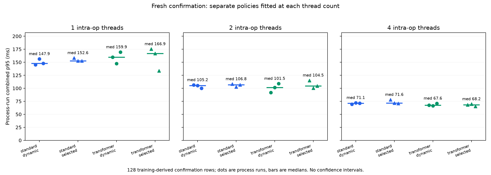
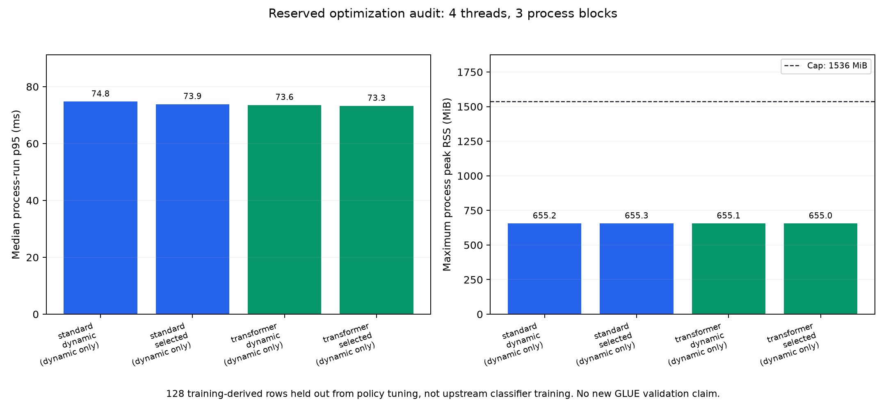

# Follow-up: per-thread refitting and transformer optimization

Completed November 9, 2026 under the
[prespecified follow-up protocol](followup-protocol.md). Refitting separately at
each thread count did not establish a benefit from retaining fixed variants.
Confirmation selected **transformer-optimized dynamic ONNX at four threads**,
with no fixed variants. Its reserved-audit median run p95 was **73.560 ms**,
versus **74.752 ms** for the standard dynamic control: about 1.6% lower, with
overlapping run ranges and a reversed direction in one matched block. This is
an exploratory small difference, not an established general speedup.

Across **93 timing processes and 24,324 requests**, every output passed the
finite-score, tolerance, and label checks, with zero changed predictions.
The original deployment policy remains unchanged. The complete evidence is in
[the follow-up archive](../results/followup-1/summary.json).

## What changed

The original confirmation reused a policy fitted at one thread while comparing
thread counts. This extension refits routes independently at 1, 2, and 4 threads.
It also compares the existing ONNX graphs with a separate FP32 family processed
by ORT's standalone transformer optimizer. Both families retain dynamic fallback
and can keep at most two fixed-length variants.

The optimizer uses the BERT interface with DistilBERT's 12 attention heads and
hidden size 768, CPU mode, raw attention masks, and GELU approximation disabled.
The checkpoint and tokenizer remain pinned. There is no fine-tuning,
quantization, FP16 conversion, or GPU execution. Both families also receive
ORT_ENABLE_ALL when loaded into CPU sessions.

## Data and measurement

Before fitting, seed 2037 allocated 512 new SST-2 training IDs: 256 for fitting,
128 for confirmation, and 128 for a reserved inference-optimization audit.
All exclude the original 64 calibration and 128 confirmation IDs. The checkpoint
was trained on SST-2 training data: the audit is held out from **policy tuning**,
and provides no independent classifier-generalization estimate. The original
validation split is not read or rerun by this extension.

Natural token lengths, including special tokens, were short in all three cohorts:

| Partition | Minimum | Median | p95 | Maximum |
| --- | ---: | ---: | ---: | ---: |
| Fitting | 3 | 9 | 31.25 | 60 |
| Confirmation | 3 | 9 | 29.65 | 53 |
| Audit | 3 | 9 | 33.65 | 41 |

No sampled natural input exceeded 128 tokens. Capacity probes and synthetic
checks exercise longer shapes, but these measurements do not evaluate natural
long-document performance.

Fitting profiles each graph in two shuffled passes, learns exact-length routes
separately for each family/thread count, and measures eligible zero/one/two-variant
configurations with all retained sessions resident. Unknown lengths use dynamic
execution. Selection requires passing output checks and peak process RSS within
1,536 MiB. Every timed output is checked after the timer against separately
computed PyTorch FP32 logits: finite scores, `atol=rtol=1e-4`, and identical labels.

Fitted policies are frozen before confirmation. Confirmation compares each
family's dynamic and fitted policies at all three thread counts in three
randomized fresh-process blocks. The candidate with the lowest median run p95,
subject to correctness and memory limits, is frozen before audit references or
timings are generated. The audit compares both families' dynamic and fitted
policies at that chosen thread count in three new blocks.

Timing includes tokenization, routing/padding, and synchronous inference, with
batch one, sequential CPUExecutionProvider, one inter-op thread, disabled idle
spinning, capacity probes, and ten warm-up requests. Startup, logging, output
comparison, and separate diagnostic traces are excluded from request timing.
Memory includes process overhead and capacity probes; the larger of 10 ms sampled
RSS and the Windows process high-water mark enforces the cap.

Report medians and full ranges across process-run p95 values. Requests within a
process are not independent statistical replications. Three blocks on one laptop
do not support precise population claims, confidence intervals, or attribution
of an observed timing change to any particular fused operator.

## Fitted policies

Thirty individual-graph profiling processes produced 14,340 timed requests.
Pruning idle variants left 15 resident-configuration replays, each with 256 fitting
rows. All 45 fitting processes passed output checks, with zero changed labels.
The fitting replays selected these policies before confirmation was opened:

| Graph family | Threads | Retained variants | Fitting p95 (ms) | Fitting peak RSS (MiB) |
| --- | ---: | --- | ---: | ---: |
| Standard | 1 | None | 151.584 | 655.2 |
| Standard | 2 | None | 111.526 | 654.0 |
| Standard | 4 | None | 74.206 | 654.6 |
| Transformer | 1 | 64 | 162.252 | 967.6 |
| Transformer | 2 | 32 | 104.711 | 967.9 |
| Transformer | 4 | None | 71.569 | 654.9 |

These are selection measurements, not independent evidence of a gain. A selected
policy with no retained variants executes the same graph as its dynamic control;
its separately timed runs measure process variation rather than a distinct model.

## Confirmation results

Each cell is the median of three process-run p95 values, followed by the full
range in milliseconds. These ranges are **not confidence intervals**. There
were 36 confirmation processes and 4,608 timed requests. All methods produced
the same 127/128 correct predictions in every run; this training-derived accuracy
is a pipeline diagnostic.

| Graph family and policy | 1 thread | 2 threads | 4 threads |
| --- | ---: | ---: | ---: |
| Standard dynamic | 147.891 [145.203, 156.262] | 105.235 [100.103, 106.216] | 71.075 [69.435, 72.042] |
| Standard fitted, no variants | 152.551 [152.551, 158.131] | 106.774 [102.636, 108.034] | 71.553 [71.004, 77.992] |
| Transformer dynamic | 159.889 [147.288, 169.338] | 101.500 [91.938, 108.796] | **67.597 [66.287, 70.804]** |
| Transformer fitted | 166.854 [133.501, 175.250] | 104.484 [100.373, 115.068] | 68.223 [65.289, 69.564] |

The transformer fitted policy uses fixed-64 at one thread, fixed-32 at two
threads, and no variants at four threads. Neither retained-variant policy beat
its own dynamic control on median run p95. Matched dynamic/fitted p95 ratios
varied in direction: 0.883-1.268 at one thread and 0.799-1.041 at two threads.
A ratio above one favors the fitted policy. This does not support a consistent
specialization gain from those candidates.

All confirmation processes passed output checks and met the memory cap. The
retained-variant policies reached approximately 968 MiB peak RSS, compared with
approximately 655 MiB for dynamic execution. The frozen candidate minimized the
prespecified median-p95 criterion; the audit did not change that choice.



## Reserved optimization audit

There were 12 audit processes and 1,536 timed requests on 128 rows held out from
inference-policy tuning. All four conditions at the chosen four-thread setting
execute dynamic graphs, because neither family retained variants at that setting.
The fitted-policy rows are separate timing repetitions of the same graph within
each family. They are retained as planned comparisons, not new candidates selected
after inspecting the audit.

| Condition, four threads | Median run p95 (ms) | Full run range (ms) | Maximum peak RSS (MiB) |
| --- | ---: | ---: | ---: |
| Standard dynamic | 74.752 | 74.732-77.758 | 655.2 |
| Standard fitted, no variants | 73.867 | 71.988-76.997 | 655.3 |
| **Transformer dynamic: frozen choice** | **73.560** | **71.787-76.698** | **655.1** |
| Transformer fitted, no variants | 73.257 | 72.728-74.682 | 655.0 |

The standard/transformer dynamic p95 ratios in matched audit blocks were
1.057, 1.041, and 0.974. The optimized family was faster in two of three blocks,
with a small difference in medians and overlapping ranges. These descriptive
observations warrant cautious follow-up rather than a reliable speedup claim.

Every audit process passed all output checks, stayed below 1,536 MiB, and agreed
on all predictions (127/128 correct). The largest absolute logit error across
all 24,324 timed requests was approximately `1.04e-5`, below the configured
comparison tolerances. This is empirical agreement on tested inputs, not proof
of equivalence for every possible input.



## What the additional optimizer changed

All five transformed graphs passed 158 pre-timing checks in total: 46 for the
dynamic graph and 28 for each fixed graph. These include original calibration
examples, boundary lengths, and full, right-padded, and internal attention masks.
The standalone optimizer added GELU-related fusions without low-precision
conversion or GELU approximation.

Separate post-audit traces used the same three-token audit example, padded to
capacity for fixed graphs, for three calls per graph. All traced nodes executed
on CPUExecutionProvider. The standard graphs executed six `Erf` operations per
call; the transformed dynamic graph instead executed six `BiasGelu` operations,
and transformed fixed graphs executed six `Gelu` operations. Both families
executed 13 `SkipLayerNormalization` and six `FusedMatMul` operations per call.
No `Attention` or `MultiHeadAttention` operator appeared in these traces.
The evidence confirms additional GELU fusions for this probe, but does not
attribute the small timing difference to a particular operator or demonstrate
identical execution at all sequence lengths.

## Interpretation and limits

The core specialization hypothesis still lacks confirmation on this CPU: the
standard selector rejected all variants after per-thread refitting, and the
two retained transformer candidates did not yield consistent confirmation gains.
The additional optimizer produced verified graph changes, while its audit
advantage was small relative to process variation. A dynamic graph remains the
best-supported form of the candidate under this protocol.

Absolute profiling and later replay timings differed substantially. The study
did not instrument CPU power, temperature, or background load, so the cause is
unresolved. Randomized blocks help distribute run-order effects but do not remove
all laptop timing variation. Compare matched conditions within this follow-up;
do not treat its timings as a direct improvement over the original validation
timings or compare them as if the workloads were identical.

All new rows came from the upstream classifier's training split. This study
adds inference-optimization evidence, not a new classifier-generalization result.
The original 872-example validation report and frozen standard dynamic policy
remain preserved. No predictor behavior changed from the follow-up results.

## Reproduction and provenance

```powershell
uv sync --locked
uv run etdl followup --name followup
# For an interrupted run, use the same immutable inputs and settings:
uv run etdl followup --name followup --resume
uv run python tools/archive_followup.py --followup artifacts/followup --output results/your-followup --traces
```

The experiment preserves the original frozen deployment policy. New results are
an exploratory extension of the [original report](final-results.md).
Measurements used code commit `01c00c5`; the archive was produced with reporting
commit `fcafbce`. It contains partition IDs and hashes, frozen plans, graph
registries and checks, reference logits, raw measurement requests, process metrics,
request-level timings, plots, and separate operator traces. Model binaries and
input text are excluded. [Checksums](../results/followup-1/checksums.json) cover
every archived file except the checksum manifest itself.

The [ORT transformer optimizer documentation](https://onnxruntime.ai/docs/performance/transformers-optimization.html)
describes graph-layout dependence of its additional fusions. Reporting principles
and methodological sources are recorded in the
[statistical protocol](comparison-protocol.md#software-and-methodological-sources).
