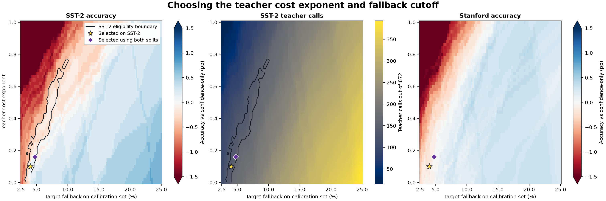

# Choosing the cost exponent and fallback cutoff

The grid tested 51 cost exponents from 0 to 1 and 91 calibration fallback
targets from 2.5% to 25%. For each pair, the code converts the target into
a fixed score cutoff using the original calibration set. It keeps both
FP32 ONNX graphs, the ridge coefficients, and the teacher cost table
fixed. The calibration target describes how many calibration requests
exceed the cutoff. The actual teacher-call rate can differ on new data.



The left and right panels show accuracy in percentage points relative to
confidence-only. Blue indicates higher accuracy. The middle panel shows
the SST-2 teacher-call count. The outlines mark settings that reached at
least 786/872 on SST-2, made at most 161 teacher calls, and stayed within
the confidence baseline's estimated teacher cost of 3.66 ms per request.
Of the 4,641 settings, 186 met all three conditions and seven exceeded
confidence-only on SST-2. The unrestricted accuracy maximum was 796/872,
requiring at least 359 calls among grid settings achieving that score.

## Fixed-cutoff comparisons

| Policy | Cost exponent | Calibration fallback target | SST-2 correct / 872 | SST-2 calls | Stanford correct / 1,812 | Stanford calls |
| --- | ---: | ---: | ---: | ---: | ---: | ---: |
| Confidence-only | — | 10% | 789 | 161 | 1,670 | 337 |
| Selected on SST-2 ★ | 0.10 | 4.00% | 790 | 141 | 1,667 | 292 |
| Selected using both splits ◆ | 0.16 | 4.75% | 790 | 149 | 1,670 | 309 |

The star marks the highest-accuracy eligible setting on SST-2, with ties
broken by lower estimated teacher cost then fewer calls. It routes to
the teacher when the score reaches 0.0924014 and comes from the grid
without using the Stanford results. It sent 50 long inputs to the
teacher and got 184 of the 208 long inputs correct. Confidence-only sent
45 and got 183 right. The paired 95% bootstrap intervals for accuracy
versus confidence-only were −0.34 to +0.57 points on SST-2 and −0.50 to
+0.17 points on Stanford. The SST-2 interval is descriptive because the
grid used SST-2 labels to choose the winner.

The diamond marks a retrospective choice. It beat confidence-only on
SST-2, tied it on Stanford, and stayed within the confidence call and
cost budgets on both. Its cutoff was 0.0754463. It was the only grid
cell that improved SST-2 accuracy while at least tying Stanford under
both sets of budgets. Both splits had been examined in earlier work.

## New IMDb reviews

Both policies were frozen before inference on 720 previously unscored
IMDb test reviews. The sample used 120 reviews per label and length group
(up to 96 tokens, 97–128 tokens, or 129–160 tokens), excluding normalized
duplicates and earlier IMDb selections. The teacher got 647 right and
the student got 630 right.

| Policy | Correct / 720 | Teacher calls | Teacher fixes | Teacher harms |
| --- | ---: | ---: | ---: | ---: |
| Confidence-only | 647 | 147 | 34 | 17 |
| Both grid choices | 643 | 213 | 37 | 24 |

The two grid choices made identical routing decisions. Of the 720 reviews,
718 share the same 33+ token teacher cost. In that group the two policies
translate to nearly identical cutoffs on predicted teacher gain. Both
made every call that confidence-only made plus 66 more. The extra calls
fixed three mistakes and introduced seven new ones. Both policies were
0.56 percentage points below confidence-only, with a descriptive paired
95% bootstrap interval of −1.39 to +0.28 points. The grid found cheaper
operating points on the short-text splits, and their cutoffs transferred
poorly to this longer-review sample.

## Reproduce

```powershell
uv run --locked python scripts/plot_gate_grid.py
uv run --locked python scripts/plot_gate_grid.py --imdb
```

The [grid plan](../results/student-study/gate-grid/plan.json) contains
the fixed thresholds. The [results](../results/student-study/gate-grid/results.json)
archive contains every cell's accuracy, call count, and estimated teacher
cost. The [IMDb audit](../results/student-study/gate-grid/imdb.json) checks
the [frozen policies](../results/student-study/gate-grid/imdb-plan.json)
using the verified teacher and student ONNX exports.
The teacher cost proxy sums the original bin medians. The 0.16 choice was
timed separately with [four matched CPU blocks](gate-grid-timing-results.md).
