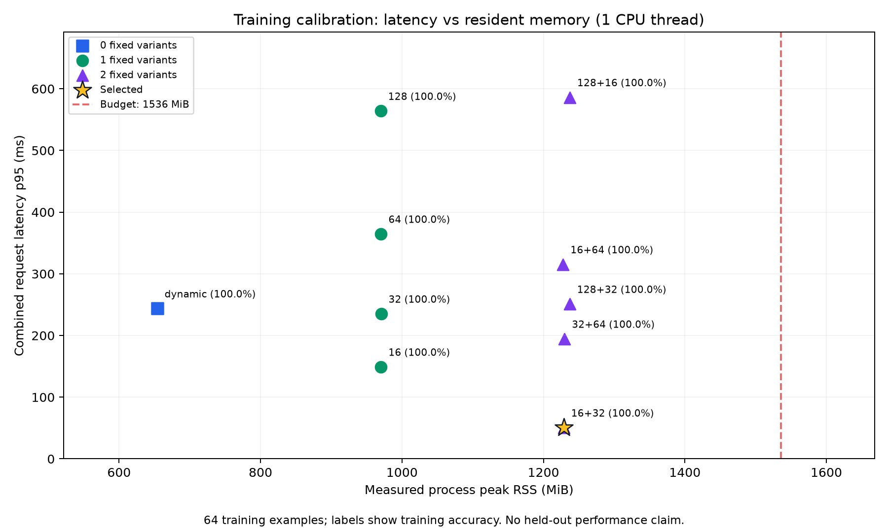

# Milestone 2: checked length specialization and measured selection

Completed November 9, 2026. The system now derives fixed-length models, verifies
them, learns routes on training data, measures resident multi-model configurations,
selects at most two variants under a memory cap, and runs the saved policy.

## Result of this calibration run

With a **1,536 MiB process-memory cap**, the selector retained **16- and 32-token
variants plus the dynamic fallback**. Measured combined p95 was **50.556 ms**,
compared with **243.758 ms** for dynamic-only in this study. Peak process RSS
increased from **653.9 MiB to 1,228.7 MiB**. There were **zero changed predictions**.

These are selection-workload measurements, not held-out speedup or accuracy
results. The checkpoint was already fine-tuned on SST-2 training data. The timing
workload is small and repeated, and configurations ran as sequential blocks in a
seeded shuffled order. System load, thermal state, cache behavior, and selection
on the same workload can affect the apparent improvement. There is no confidence
interval or claim that this gain will generalize.



## Protocol

- Same Intel i5-1334U / Windows development machine as milestone 1.
- Same pinned DistilBERT FP32 checkpoint and 64 SST-2 **training** examples, seed
  2027, with lengths 3-37 including special tokens. The validation split was not
  used for calibration, correctness checks, timing, or selection.
- Batch one, CPUExecutionProvider, ORT_ENABLE_ALL, one intra-op thread per session,
  one inter-op thread, 10 warm-up requests and three shuffled repetitions.
- Five execution options profiled separately. Per-length median combined latency,
  including padding preparation, determines the fastest eligible route.
- Eleven possible subsets of size zero, one, or two were considered. The 64+128
  subset was pruned because a retained variant never won any route; ten
  configurations were replayed in separate processes with all retained sessions
  resident. Each configuration contains the dynamic model.
- Before timing, every loaded model receives a full-capacity probe: 512 tokens
  for dynamic, the fixed capacity for each variant. This contributes to measured
  peak memory, followed by warm-up. It is excluded from per-request latency.
- Memory uses the larger of 10 ms sampled process RSS and Windows' lifetime
  high-water mark. It includes Python/tokenizer overhead and session startup.
  It does not add individual peaks or substitute on-disk model size for memory.
- All ten measured configurations fit the chosen cap. This run therefore does not
  demonstrate an active memory constraint changing the selected configuration;
  smaller-cap selection and infeasibility are covered by automated tests.

## All measured configurations

Dynamic fallback is retained in every row. Accuracy is a training diagnostic.

| Fixed variants retained | Median (ms) | p95 (ms) | Peak RSS (MiB) | Training accuracy | Changed predictions |
| --- | ---: | ---: | ---: | ---: | ---: |
| None | 100.439 | 243.758 | 653.9 | 100% | 0 |
| 16 | 81.655 | 149.113 | 970.4 | 100% | 0 |
| 32 | 141.019 | 235.169 | 970.5 | 100% | 0 |
| 64 | 60.788 | 364.633 | 970.4 | 100% | 0 |
| 128 | 54.858 | 563.979 | 970.0 | 100% | 0 |
| **16 + 32** | **22.504** | **50.556** | **1,228.7** | **100%** | **0** |
| 16 + 64 | 83.960 | 315.285 | 1,227.8 | 100% | 0 |
| 16 + 128 | 84.985 | 586.166 | 1,237.3 | 100% | 0 |
| 32 + 64 | 138.606 | 194.478 | 1,229.8 | 100% | 0 |
| 32 + 128 | 158.915 | 251.026 | 1,237.1 | 100% | 0 |

## Correctness and routing

The four variants are derived from the checked dynamic ONNX graph using ORT's
shape-fixing helpers and existing graph passes. Initializer digests are checked
before and after specialization; no weights are trained or quantized.

| Fixed capacity | Eligible training examples checked | Output comparisons | Changed labels |
| --- | ---: | ---: | ---: |
| 16 | 47 | 110 | 0 |
| 32 | 62 | 140 | 0 |
| 64 | 64 | 144 | 0 |
| 128 | 64 | 144 | 0 |

All **538 variant comparisons** passed, in addition to the baseline's 98 checks.
Each variant is compared with dynamic outputs both at the original length and
with identical padding. Synthetic boundary lengths and internal masks are also
checked. Passing requires finite logits within `atol=rtol=1e-4` and identical
argmax labels. This remains empirical verification, not universal equivalence.

The saved policy chooses 16 or 32 only for measured lengths where that variant
won. Lengths 33 and 37 use dynamic; every unseen length also uses dynamic. No
input is shortened to fit. Inputs beyond the encoder's 512-token limit are rejected.

The public `predict` command successfully classified "Great service!" as positive
using fixed-16. Additional functional smoke checks cover a negative sentence and a
140-token message using dynamic fallback. These first-request timings are separate
from warmed benchmark timings. Readiness metrics exclude Python module imports and
do not establish cold-device application startup time.

The router checks policy provenance and CPU/runtime identity, then loads only the
dynamic model and the selected variants. Missing or changed fixed models are
disabled; an invalid dynamic fallback aborts. Decisions are logged without input
text. All **29 automated tests** pass, including incomplete-check coverage,
changed tolerances, memory infeasibility, overflow fallback and missing-variant fallback.

## Reproducible evidence

[The archived snapshot](../results/milestone-2/summary.json) records measurement
code commit `32f7a38`, CPU/runtime details, checkpoint and dataset commits, artifact
hashes, training row IDs, configuration metrics, and the frozen policy.
The same directory contains:

- `profile-requests.csv` and `configuration-requests.csv`: individual request
  timings, labels, predictions, token lengths, repetitions and route decisions.
- `verification.json` and `model-manifests.json`: output-check summaries,
  unchanged-weight digests, sizes and optimized operator inventories.
- `selection.json`, `configurations.csv`, PNG/SVG plots, and file checksums.
- `smoke-predictions.json`: functional prediction and fallback results.

Model binaries and caches stay local and are excluded from Git. Archive another
completed run with:

```powershell
uv run python tools/archive_study.py --study artifacts/study-t1 --output results/your-run
```

The next experiment should expand training-only calibration and use independent,
randomized repeated configuration runs at 1/2/4 threads. Add PyTorch and simple
bucket comparisons, memory-cap and other ablations, and controlled startup
measurements. Freeze the final policy before evaluating the held-out 872 examples.
