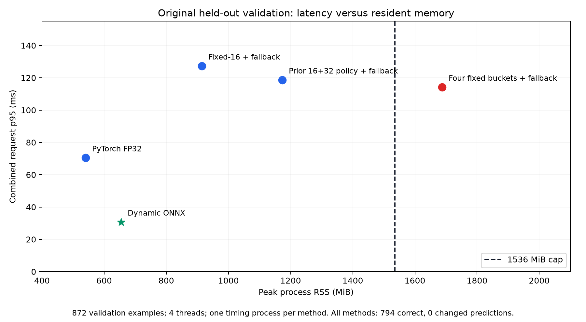
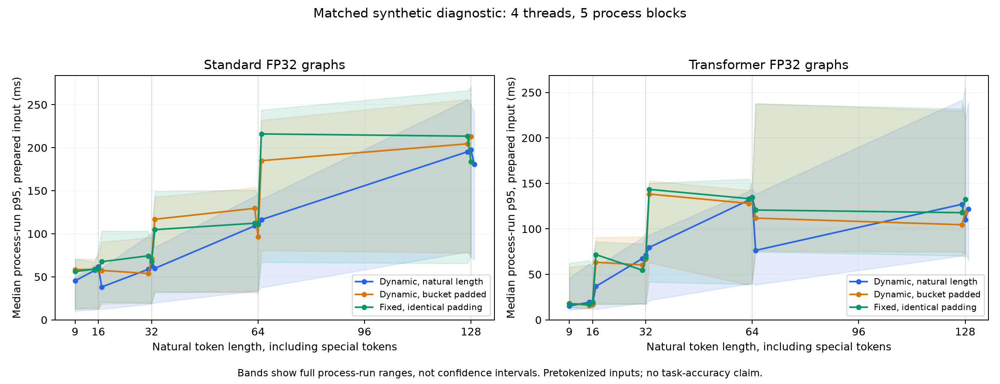
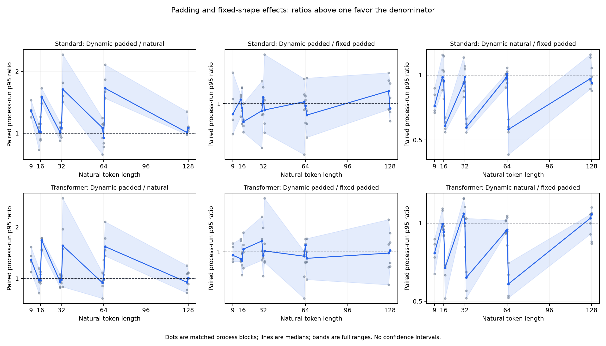
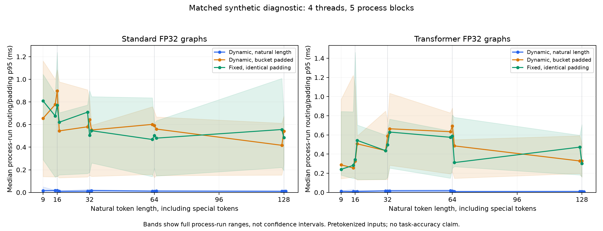
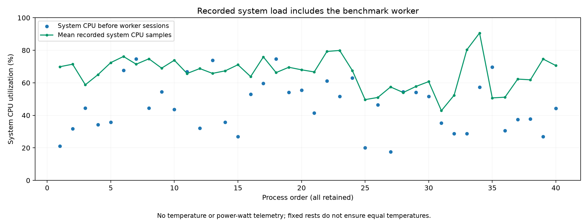

# Matching CPU computation to message length

Consolidated project report

The completed natural-workload experiments support dynamic-only ONNX execution at four threads on the measured Intel Core i5-1334U CPU. Keeping fixed-length variants did not deliver a consistent confirmed deployment benefit under the sampled workloads and memory budget. The follow-up optimizer showed a small, variable timing difference. These findings support a measured decision to retain no variants; they do not establish that specialization cannot help on other hardware or workloads. <!-- claim:C001; evidence:E002,E003,E004,E005 -->

## Question and implementation

The project asks whether keeping at most two checked 16/32/64/128-token DistilBERT variants alongside a dynamic fallback can reduce CPU p95 latency within a 1,536 MiB process-memory budget. Inputs are never truncated to fit a variant, and lengths without a verified route use the dynamic graph. Choosing no variants is an allowed outcome in the original proposal. <!-- claim:C002; evidence:E001,E004 -->

The pipeline pins a pretrained SST-2 classifier, exports FP32 ONNX graphs, verifies scores and labels, profiles eligible routes, measures resident configurations, and freezes a policy before evaluation. The measured machine runs Windows 11 with ONNX Runtime 1.31.1. The original deployed policy uses the standard dynamic graph, four intra-op threads, sequential CPUExecutionProvider, one inter-op thread, and disabled idle spinning. The project performs no model training, quantization, or GPU execution. <!-- claim:C003; evidence:E004,E009,E010 -->

## Original confirmation and held-out validation

Original training confirmation compared five methods at 1/2/4 threads in three randomized process blocks. Deployment selection compared dynamic ONNX and the prior 16+32 policy across those thread counts; PyTorch, single-fixed, and bucket methods were comparators. It selected standard dynamic ONNX at four threads. The policy was frozen before the full 872-example GLUE SST-2 validation split was accessed; the previously fitted 16+32 policy remained a comparison after it was rejected for deployment. <!-- claim:C004; evidence:E002,E003,E004,E011 -->

All five methods agreed on all 872 validation predictions: 794 correct, or 91.06% accuracy, with zero changed labels against the PyTorch reference. The following timings use one validation process per method and have no latency confidence intervals. <!-- claim:C005; evidence:E003 -->

| Method | Median (ms) | p95 (ms) | Peak RSS (MiB) |
| --- | ---: | ---: | ---: |
| PyTorch FP32 | 41.720 | 70.450 | 540.5  <!-- claim:C006; evidence:E003 --> |
| Dynamic ONNX | 16.748 | 30.695 | 654.8  <!-- claim:C007; evidence:E003 --> |
| Fixed-16 + fallback | 30.961 | 127.295 | 914.8  <!-- claim:C008; evidence:E003 --> |
| Four fixed buckets + fallback | 51.482 | 114.165 | 1,687.5  <!-- claim:C009; evidence:E003 --> |
| Prior 16+32 policy + fallback | 89.269 | 118.657 | 1,173.3  <!-- claim:C010; evidence:E003 --> |



| Method | Retained model files (MiB) | Model/session initialization (s) | Ready after probes and warm-up (s) |
| --- | ---: | ---: | ---: |
| PyTorch FP32 | 255.4 | 0.644 | 1.627  <!-- claim:C011; evidence:E003 --> |
| Dynamic ONNX | 256.1 | 0.590 | 1.300  <!-- claim:C012; evidence:E003 --> |
| Fixed-16 + fallback | 512.2 | 1.208 | 3.295  <!-- claim:C013; evidence:E003 --> |
| Four fixed buckets + fallback | 1,280.4 | 4.443 | 6.178  <!-- claim:C014; evidence:E003 --> |
| Prior 16+32 policy + fallback | 768.2 | 4.174 | 6.443  <!-- claim:C015; evidence:E003 --> |

Readiness includes capacity probes and warm-up but excludes process imports, tokenizer loading, and provenance checks. OS caches may be warm; these are not cold-device startup measurements. Serialized sizes count retained original model files, excluding tokenizer assets and extra optimized inspection copies. RSS includes process overhead and is the larger of sampled process memory and the Windows lifetime high-water mark. <!-- claim:C016; evidence:E003,E011 -->

The four-bucket comparison exceeded the memory cap. The dynamic result is one timing observation on this workload, not a stable population estimate. Later experiment timings use different inputs and operating periods, so they must not be read as direct improvements over these validation numbers. <!-- claim:C017; evidence:E003,E005,E009 -->

## Follow-up: refitting by thread count and transformer optimization

The follow-up allocated 256 fitting, 128 confirmation, and 128 audit rows from previously unused SST-2 training IDs. It refitted policies independently at each thread count and compared standard graphs with a separate transformer-optimized FP32 family. Across 93 timing processes and 24,324 requests, all output checks passed with zero changed predictions. The classifier was trained on SST-2 training data, so these new partitions are held out from inference-policy tuning only. <!-- claim:C018; evidence:E005,E009 -->

Confirmation chose transformer-optimized dynamic ONNX at four threads, retaining no fixed variants. On the reserved optimization audit, its median process-run p95 was 73.560 ms versus 74.752 ms for standard dynamic ONNX, approximately 1.6% lower. Full ranges overlapped, and one of the three matched blocks reversed direction. This does not establish a reliable speedup. The original deployed policy was preserved. <!-- claim:C019; evidence:E004,E005 -->

Detailed methods and all comparisons: [follow-up report](followup-results.md).

## Matched length-boundary diagnostic

The first diagnostic had long telemetry interruptions, including a gap exceeding 21,000 seconds. A recorded timing-quality amendment required retaining that entire run and making one separate replication with the unchanged measurement code and design. The original archive contains 40 processes and 8,880 requests; its output checks passed. Its complete results remain available separately. The replication below had no gaps above the recorded ten-second telemetry threshold. The two runs are not pooled. <!-- claim:C020; evidence:E006,E007,E012,E013 -->

Interrupted-run evidence: [complete results](../results/boundaries-interrupted/summary.json) and [recorded system load](../results/boundaries-interrupted/system-load.png).

The final diagnostic used 40 fresh processes in 5 randomized blocks at 4 threads, with 8,880 timed requests. Thirty-nine synthetic pretokenized inputs covered three token patterns and lengths 9, 15/16/17, 31/32/33, 63/64/65, and 127/128/129. Every input/path was checked against separately generated PyTorch FP32 references. These are execution probes without task labels or accuracy claims. <!-- claim:C021; evidence:E006,E007,E010,E014 -->

For lengths up to 128, each process compared dynamic natural-length execution, dynamic execution padded to the smallest fitting bucket, and the matching fixed graph with identical padded token IDs and masks. Length 129 exercised dynamic fallback. Routing/padding and inference were timed separately; their sum excludes tokenization and is not text-to-label end-to-end latency. Both dynamic and fixed sessions were resident in each process. Lengths assigned to different capacities were measured in different fresh processes, so cross-length curves also contain process variation; the ratios compare matched paths within the same process. <!-- claim:C022; evidence:E007,E010 -->

| Family | Length | Dynamic natural p95 (ms) | Dynamic padded p95 (ms) | Fixed padded p95 (ms) | Natural/fixed paired ratio |
| --- | ---: | ---: | ---: | ---: | ---: |
| Standard | 9 | 45.417 | 58.529 | 56.166 | 0.718  <!-- claim:C023; evidence:E006 --> |
| Standard | 15 | 57.634 | 58.757 | 58.950 | 0.978  <!-- claim:C024; evidence:E006 --> |
| Standard | 16 | 61.739 | 57.760 | 59.415 | 0.937  <!-- claim:C025; evidence:E006 --> |
| Standard | 17 | 38.178 | 57.426 | 67.579 | 0.581  <!-- claim:C026; evidence:E006 --> |
| Standard | 31 | 58.735 | 53.908 | 74.425 | 0.914  <!-- claim:C027; evidence:E006 --> |
| Standard | 32 | 62.922 | 71.058 | 67.838 | 0.979  <!-- claim:C028; evidence:E006 --> |
| Standard | 33 | 59.887 | 116.874 | 104.817 | 0.571  <!-- claim:C029; evidence:E006 --> |
| Standard | 63 | 109.161 | 129.563 | 112.278 | 0.967  <!-- claim:C030; evidence:E006 --> |
| Standard | 64 | 112.412 | 96.453 | 110.909 | 1.014  <!-- claim:C031; evidence:E006 --> |
| Standard | 65 | 116.427 | 184.983 | 216.034 | 0.560  <!-- claim:C032; evidence:E006 --> |
| Standard | 127 | 195.375 | 204.547 | 213.411 | 0.961  <!-- claim:C033; evidence:E006 --> |
| Standard | 128 | 197.747 | 213.203 | 183.567 | 0.919  <!-- claim:C034; evidence:E006 --> |
| Standard | 129 | 180.782 | N/A | N/A | N/A  <!-- claim:C035; evidence:E006 --> |
| Transformer | 9 | 15.305 | 18.191 | 17.682 | 0.766  <!-- claim:C036; evidence:E006 --> |
| Transformer | 15 | 19.319 | 15.866 | 17.021 | 0.990  <!-- claim:C037; evidence:E006 --> |
| Transformer | 16 | 17.347 | 17.558 | 19.481 | 0.921  <!-- claim:C038; evidence:E006 --> |
| Transformer | 17 | 36.816 | 63.307 | 71.774 | 0.672  <!-- claim:C039; evidence:E006 --> |
| Transformer | 31 | 67.483 | 60.401 | 54.557 | 1.085  <!-- claim:C040; evidence:E006 --> |
| Transformer | 32 | 71.098 | 66.815 | 68.688 | 1.000  <!-- claim:C041; evidence:E006 --> |
| Transformer | 33 | 79.584 | 138.318 | 143.430 | 0.616  <!-- claim:C042; evidence:E006 --> |
| Transformer | 63 | 131.682 | 127.938 | 133.231 | 0.929  <!-- claim:C043; evidence:E006 --> |
| Transformer | 64 | 134.897 | 134.257 | 134.238 | 0.942  <!-- claim:C044; evidence:E006 --> |
| Transformer | 65 | 76.373 | 111.848 | 120.752 | 0.583  <!-- claim:C045; evidence:E006 --> |
| Transformer | 127 | 127.044 | 104.573 | 117.830 | 1.042  <!-- claim:C046; evidence:E006 --> |
| Transformer | 128 | 110.263 | 118.257 | 132.407 | 1.079  <!-- claim:C047; evidence:E006 --> |
| Transformer | 129 | 121.991 | N/A | N/A | N/A  <!-- claim:C048; evidence:E006 --> |

Table latencies are medians of process-run p95 values. Ratios are medians of within-process natural/fixed p95 ratios, not ratios of the table medians; values above one favor fixed execution. These descriptive comparisons do not retune a policy or establish a natural-workload aggregate speedup. Full ranges, individual block ratios, and every request are retained in the diagnostic archive. <!-- claim:C049; evidence:E006,E010 -->

For the standard family, padding immediately above bucket boundaries increased dynamic-graph p95 by paired median factors of 1.504 at 17-to-32 tokens, 1.636 at 33-to-64 tokens, and 1.656 at 65-to-128 tokens. At nine tokens, padding to 16 had a paired median factor of 1.289. These ratios compare the same dynamic graph and token pattern within each process, with padding masked and outputs checked. <!-- claim:C050; evidence:E006,E007,E010 -->

For the standard family, considering fixed versus dynamic execution with identical padding, fixed execution had lower p95 in every block at 0 of 12 lengths, higher p95 in every block at 0 lengths, and mixed or tied directions at 12 lengths. This summarizes the observed blocks only and is not a significance test or a guarantee for natural messages. <!-- claim:C051; evidence:E006 -->

For the standard family, considering fixed padded execution versus natural-length dynamic execution, fixed execution had lower p95 in every block at 0 of 12 lengths, higher p95 in every block at 4 lengths, and mixed or tied directions at 8 lengths. This summarizes the observed blocks only and is not a significance test or a guarantee for natural messages. <!-- claim:C052; evidence:E006 -->

For the transformer family, padding immediately above bucket boundaries increased dynamic-graph p95 by paired median factors of 1.677 at 17-to-32 tokens, 1.556 at 33-to-64 tokens, and 1.538 at 65-to-128 tokens. At nine tokens, padding to 16 had a paired median factor of 1.287. These ratios compare the same dynamic graph and token pattern within each process, with padding masked and outputs checked. <!-- claim:C053; evidence:E006,E007,E010 -->

For the transformer family, considering fixed versus dynamic execution with identical padding, fixed execution had lower p95 in every block at 0 of 12 lengths, higher p95 in every block at 1 lengths, and mixed or tied directions at 11 lengths. This summarizes the observed blocks only and is not a significance test or a guarantee for natural messages. <!-- claim:C054; evidence:E006 -->

For the transformer family, considering fixed padded execution versus natural-length dynamic execution, fixed execution had lower p95 in every block at 1 of 12 lengths, higher p95 in every block at 4 lengths, and mixed or tied directions at 7 lengths. This summarizes the observed blocks only and is not a significance test or a guarantee for natural messages. <!-- claim:C055; evidence:E006 -->

These matched contrasts separate the added cost of padding from the effect of fixing a graph shape at the same padded input size. Where padding costs more than fixed-shape execution saves, the fixed variant loses to natural-length dynamic execution. This provides a testable explanation for the observed pattern rather than attributing all latency differences to routing or to an individual fused operator. It does not prove that the same mechanism explains every earlier natural-workload timing difference. <!-- claim:C056; evidence:E006,E007,E010 -->





The largest median process-run routing/padding p95 across diagnostic conditions was 0.899 ms. The separate inference measurements and padding contrasts therefore help distinguish input preparation from the model execution cost of a padded shape. This is the diagnostic bucket lookup and padding path, not a measurement of the learned production router. Per-request component times add, but separately aggregated component p95 values need not add to the prepared-input p95. <!-- claim:C057; evidence:E006,E007,E010 -->



Before/after AC connection and Windows power-scheme snapshots matched the recorded plan in every replication process. System and worker CPU load were recorded, and no replication process was excluded based on its performance. Snapshots cannot guarantee constant conditions between observations. System utilization includes the benchmark worker. Temperature, watts, clock speed, and affinity were not controlled; fixed two-second rests do not guarantee equal temperatures or repair earlier timing drift. <!-- claim:C058; evidence:E006,E007,E010,E014 -->



## Reproduction and functional demonstration

```powershell
uv sync --locked
uv run pytest -q
uv run etdl predict "Great service!"
uv run python tools/demo.py
uv run etdl boundaries --name boundaries
# Resume only the same frozen diagnostic inputs:
uv run etdl boundaries --name boundaries --resume
```

The demonstration reuses the original frozen four-thread dynamic policy and retains no fixed variants. Its output records labels, logits, token counts, routes, and the policy digest. It is a functional demonstration, not a benchmark. The archived example uses two public sample sentences, and does not replace the complete validation evidence. <!-- claim:C059; evidence:E004,E008 -->

The repository [README](../README.md) contains preparation, export, checking, selection, confirmation, and archive commands. Model binaries and downloaded datasets are regenerated locally rather than committed.

## Limits, evidence, and conclusion

The main limitation is scope: one laptop CPU, few process blocks, timing variation, short natural follow-up messages, and synthetic diagnostic inputs. Original validation timing has only one process per method. Repeated requests within a process are dependent observations, and no formal significance tests or confidence intervals are claimed. There is no new classifier-generalization estimate from the training-derived audit or the synthetic probes. <!-- claim:C060; evidence:E003,E005,E006,E009,E010 -->

The supported deployment decision is to keep standard dynamic ONNX at four threads for the measured setup. A bounded selector is useful when it can reject extra variants after output, memory, and confirmation checks. Further experiments on other devices, longer natural workloads, or quantization would answer additional questions; none is necessary to change this project's observed conclusion. <!-- claim:C061; evidence:E001,E002,E003,E004,E005,E006 -->

Detailed experiment records: [original final results](final-results.md), [follow-up](followup-results.md), and [diagnostic protocol](boundary-protocol.md). Numeric claims are mapped to local artifact hashes in [the evidence record](../results/project-summary/evidence.json).

Codex assisted code implementation, experiment orchestration, analysis, and report drafting. This repository report is prepared for the project author's review; human verification and author approval are not asserted by the automated evidence audit.

## Subsequent targeted replication

After this consolidated report, we tested the post hoc 31-token synthetic lead on 64 previously unused real SST-2 training sentences and ran a separate OpenVINO CPU shape comparison. The transformer-optimized ORT fixed-32 lead did **not** meet its prespecified confirmation threshold: natural-dynamic/fixed p95 ratios were mixed across five fresh process blocks (median 1.005). OpenVINO's standard fixed-32 graph was faster than its dynamic graph on identical padded 32-token inputs in all five blocks (median ratio 1.073), but its net advantage over natural-length dynamic was small and reversed in one block (median 1.024). Absolute OpenVINO p95 varied widely between process blocks. These observations do not alter the dynamic-only deployment decision above. Full methods, all five process results, output checks, and limitations are in the [subsequent report](real31-results.md) and [new archive](../results/real31/summary.json); they are not part of the earlier project-summary evidence numbering.

An additional [real-text break-even map](breakeven-map-results.md) compared natural dynamic, padded dynamic, and equally padded fixed execution at eleven exact token lengths across standard-graph ORT and OpenVINO. None of 22 backend/length cells met the frozen candidate screen for independent fixed-route confirmation. Both backends showed consistent natural-dynamic wins immediately above the 16- and 32-token bucket boundaries; near 31–32 tokens, OpenVINO's net result changed direction between process blocks. The [archive](../results/breakeven-map/summary.json) preserves 18 processes and 9,504 checked timed requests. This map narrows the plausible region for future work but provides no new deployment winner and no precise crossover threshold.
